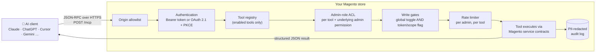

<h1 align="center">Risecommerce Magento 2 MCP Connector Free ( self hosted ) </h1>
<h3 align="center">Connect your Magento 2 store to Claude, ChatGPT, Manus and any AI agent</h3>

<p align="center">
  
  
  
  
  
  
</p>

<p align="center">
  <b>Talk to your Magento store in plain English.</b><br>
  Ask an AI agent to look up orders, fix product data, check stock, run reports, publish CMS pages or find out why a cron job didn't run, with every action checked against your admin permissions and recorded in an audit log.
</p>

<p align="center">
  📖 <b><a href="https://risecommerce.com/magento/mcp-connector">Read more about Risecommerce Magento 2 MCP →</a></b>
  &nbsp;·&nbsp;
  🧩 <b><a href="https://risecommerce.com/store/magento-2-extensions.html">More Magento 2 extensions →</a></b>
</p>

### 🤖 Works with the AI tools you already use

| AI assistants and agents | Coding agents and IDEs | Automation and SDKs |
|---|---|---|
| Claude (web, Desktop, mobile)<br>ChatGPT<br>**Manus**<br>Devin<br>Microsoft Copilot Studio<br>Mistral Work<br>Raycast<br>Goose | Claude Code · OpenAI Codex<br>Cursor · Windsurf<br>GitHub Copilot (VS Code agent mode)<br>Gemini CLI · Gemini Code Assist<br>JetBrains AI Assistant · Junie<br>Zed · Cline · Kilo Code · Continue<br>Kimi Code · Grok Build · OpenCode<br>Mistral Vibe · Pi · fx · LM Studio | n8n<br>OpenAI Agents SDK / Responses API<br>Anthropic SDK<br>LangChain · LlamaIndex · Vercel AI SDK<br>MCP Inspector |

<p align="center"><i>…and any other client that supports remote MCP servers. <a href="#-works-with-these-ai-platforms">See how each one connects ↓</a></i></p>

---

## What is this?

**Risecommerce Magento 2 MCP** is a Magento 2 extension that turns your store into a **[Model Context Protocol](https://modelcontextprotocol.io/specification/2025-06-18) (MCP) server**. MCP is the open standard that AI assistants use to call external tools. Once this extension is installed, an AI assistant connected to your store can read your store's data and, if you allow it, make changes.

You keep control of what it can do. The AI acts as a real Magento admin user, so it can only do what that user's role allows in the admin panel. Write access is off unless you turn it on in two places, and every request is written to a PII-redacted audit log.

> 💬 *"Why hasn't order #000001234 shipped yet?"*
> The AI calls `sales.order.get`, `sales.order.shipments` and `customer.customer.get`, then answers: *"It was invoiced on Monday but no shipment has been created. The customer has 6 previous orders and none were late. Do you want me to create the shipment and add tracking?"*

## ✅ Compatibility

| Platform | Supported |
|---|---|
| **Magento Open Source** | 2.4.8 and newer |
| **Adobe Commerce** (on-premise and Cloud) | 2.4.8 and newer |
| **Mage-OS** | Releases built on Magento 2.4.8 or newer |
| **Hyvä Themes / Hyvä Commerce** | Compatible (works on the backend, so it doesn't depend on the theme). Optional Hyvä Commerce tool module available |
| **Multi-Source Inventory (MSI)** | Supported through the Inventory tools module |
| **Multi-store / multi-website** | Supported; tools respect the store scope of the admin role |
| **PHP** | Whatever your Magento 2.4.8+ release requires |

## 🤖 Works with these AI platforms

Any AI client that supports **remote MCP servers over Streamable HTTP** can connect. Clients that support only local (stdio) servers can connect through the [`mcp-remote`](https://www.npmjs.com/package/mcp-remote) bridge.

**AI assistants and agent platforms**

| AI tool | What it's for | How it connects | Auth |
|---|---|---|---|
| **Claude** (claude.ai web, Desktop, mobile) | General AI assistant | Custom connector | OAuth 2.1 |
| **ChatGPT** (Developer mode) | General AI assistant | Custom MCP connector | OAuth 2.1 |
| **Manus** | Autonomous general-purpose agent | Connectors → Custom MCP → add by URL, with an `Authorization` header | Bearer token |
| **Devin** | Autonomous software engineer | Custom MCP server, HTTP transport, with headers | Bearer token or OAuth |
| **Microsoft Copilot Studio** | Enterprise agents | MCP server connection | OAuth 2.1 / API key |
| **Mistral Work** | Enterprise AI assistant | Custom MCP Connector (added by an admin) | OAuth 2.1 / Bearer |
| **Raycast** | Desktop productivity assistant | Install MCP Server → HTTP, with headers | Bearer token or OAuth |
| **Goose** | Open-source general-purpose agent | Remote (Streamable HTTP) extension | Bearer token |

**Coding agents and IDEs**

| AI tool | What it's for | How it connects | Auth |
|---|---|---|---|
| **Claude Code** | Terminal coding agent | `claude mcp add --transport http` | Bearer token or OAuth |
| **OpenAI Codex** (CLI, IDE extension, desktop app) | Autonomous coding | `codex mcp add --url` or `~/.codex/config.toml` | Bearer token or OAuth |
| **Google Gemini CLI** | Terminal coding agent | `httpUrl` in `~/.gemini/settings.json` | Bearer token |
| **Google Gemini Code Assist** | Coding in VS Code (agent mode) | Same `~/.gemini/settings.json` as Gemini CLI | Bearer token |
| **GitHub Copilot** | Agent mode in VS Code | `.vscode/mcp.json` | Bearer token or OAuth |
| **Cursor** | AI code editor | `~/.cursor/mcp.json` | Bearer token |
| **Windsurf** | AI IDE | `~/.codeium/windsurf/mcp_config.json` | Bearer token |
| **JetBrains AI Assistant / Junie** | Coding in IntelliJ, PhpStorm and other JetBrains IDEs | Settings → Tools → AI Assistant → MCP (Streamable HTTP); Junie can use the same servers | Bearer token |
| **Zed** | AI code editor | Context server settings | Bearer token |
| **Cline** | Open-source coding agent | MCP Servers → Remote Servers → Streamable HTTP | Bearer token or OAuth |
| **Kilo Code** | AI coding agent | `type: "streamable-http"` with headers | Bearer token or OAuth |
| **Kimi Code** | AI coding agent | Remote HTTP MCP server | Bearer token |
| **Grok Build** | xAI coding agent | Remote HTTP MCP server | Bearer token |
| **OpenCode** | Open-source terminal agent | Remote MCP server in `opencode.json` | Bearer token or OAuth |
| **Mistral Vibe** | Terminal coding agent | `vibe mcp add` or `~/.vibe/config.toml` | Bearer token or OAuth |
| **Pi**, **fx** | Terminal coding agents | Remote HTTP MCP server | Bearer token |
| **Continue**, **LM Studio** | IDE assistant / local models | Remote MCP or `mcp-remote` | Bearer token |

**Automation, SDKs and testing**

| Tool | How it connects | Auth |
|---|---|---|
| **n8n** | MCP Client Tool node | Bearer token |
| **OpenAI Agents SDK / Responses API** | Remote MCP tool | Bearer token |
| **Anthropic SDK, LangChain, LlamaIndex, Vercel AI SDK, custom agents** | Any MCP client library | Bearer token |
| **MCP Inspector** | Testing and debugging | Bearer token or OAuth |

> **Cloud-hosted agents** (Claude, ChatGPT, Manus, Devin, Mistral Work) connect from their own servers, so your store's `/mcp` endpoint must be reachable over public HTTPS. If a client is refused, check the audit log, and add the client's origin under **Security → Allowed Origins** if needed.

The default **Allowed Origins** list already includes Claude, ChatGPT, Gemini, Copilot, Grok, Perplexity and localhost, so the common browser-based clients work without extra configuration.

---

## Contents

- [What it can do](#-what-it-can-do)
- [Example tasks by module](#-example-tasks-by-module)
- [How it works](#️-how-it-works)
- [Installation](#-installation)
- [Included modules and tools](#-included-modules-and-tools)
- [Optional add-on modules](#-optional-add-on-modules)
- [Configuration](#️-configuration)
- [Connecting an AI agent](#-connecting-an-ai-agent)
- [Managing tools](#managing-tools)
- [Configuration writing](#configuration-writing)
- [Security](#-security)
- [Extending](#-extending--write-your-own-tools)
- [FAQ](#-faq)
- [Support and contributing](#-support-and-contributing)

---

## ✨ What it can do

**130+ tools** across the store, grouped by area:

| Area | Ask the AI things like… |
|---|---|
| 🛒 **Orders and sales** | "Show unshipped orders from last week", "Invoice and ship order 1234 with UPS tracking 1Z…", "Put order 1250 on hold and add a comment", "Refund the damaged item on order 1190" |
| 📦 **Catalog** | "Find products with no image", "Update the price of SKU ABC-1 to $49", "Create a category 'Winter Sale' under Women", "Upload this photo as the main image" |
| 🏬 **Inventory (MSI)** | "What's the salable qty of SKU X and which reservations hold it?", "Move 20 units from Warehouse A to Warehouse B", "Assign these SKUs to the new source" |
| 👤 **Customers** | "Find the customer with email jane@…", "Add a shipping address for customer 88", "Resend the confirmation email", "Trigger a password reset" |
| 📝 **CMS** | "Update the shipping policy page", "Create a homepage banner block", "List pages that are disabled" |
| 🎯 **Marketing** | "Create 50 unique coupon codes for the BLACKFRIDAY rule", "Disable the 10% catalog rule", "Which cart rules are active?" |
| 💱 **Tax and currency** | "Add a 7% tax rate for Florida", "Import today's exchange rates", "What currencies are allowed?" |
| 📊 **Reports** | "Bestsellers this month", "Abandoned carts over $200", "Low-stock products", "Revenue last 30 days vs the 30 days before", "Top search terms with zero results" |
| ⚙️ **System and DevOps** | "Which indexers are invalid? Reindex them", "Flush the full-page cache", "Why didn't the sitemap cron run?", "Grep `exception.log` for 'CyberSource'", "Which modules are installed?" |

**Built-in prompts.** The server also ships MCP *prompts*, reusable workflows the AI client can offer as one-click actions (see `Mcp/Prompt/System`).

---

## 💡 Example tasks by module

Click a module to see real requests you can give your AI assistant, and what the extension does with each one.

<details>
<summary><b>⚙️ System tools</b> (base module): cache, indexers, cron, logs, configuration</summary>

**"Which indexers are out of date? Fix them."**
It lists every indexer with its status, reindexes the invalid ones, and can switch an indexer between *Update on Save* and *Update by Schedule*.

**"Clear the cache after my product import."**
It lists cache types, then cleans or flushes them. It can also enable or disable individual cache types.

**"Why didn't the sitemap or catalog price rule cron run last night?"**
It shows each cron job's last success and last error, and flags jobs that look stuck.

**"Search exception.log for payment errors from today."**
It lists the log files in `var/log`, shows the last lines of one, or searches it for text such as "CyberSource", without needing server access.

**"What's the store's current setting for guest checkout?"**
It reads any configuration value as the store actually uses it. If you've put a path on the allowlist, it can also change it.

**"Which store views and websites do we have, and which modules are installed?"**
It lists stores, store views and installed modules. This tells the AI which tools the store can support.

**"Any admin notifications I should know about?"**
It reads the admin inbox messages.

</details>

<details>
<summary><b>🛒 Order tools</b>: orders, invoices, shipments, credit memos</summary>

**"Why hasn't order #1234 shipped?"**
It shows the order with its status, items, payment, invoices, shipments and comments.

**"Invoice and ship order #1234 with UPS tracking 1Z999…"**
It creates the invoice and the shipment, then adds the tracking number.

**"Refund the damaged item on order #1190."**
It creates a credit memo for the chosen items.

**"Put order #1250 on hold until the customer confirms the address."**
It holds the order and adds a comment. Later it can release the hold or cancel the order.

**"Show unshipped orders from last week over $500."**
It searches orders by status, date and total.

**"Which payment method was used on order #1300?"**
It shows the order's payment details.

</details>

<details>
<summary><b>📦 Catalog tools</b>: products, categories, images, stock</summary>

**"Change the price of SKU ABC-1 to $49 and set it to out of stock."**
It updates the product, including its price, status and stock.

**"Find products with no image or no description."**
It searches products by their attributes.

**"Upload this photo as the main image for SKU X."**
It adds, replaces or removes product images and sets their roles.

**"Create a 'Winter Sale' category under Women."**
It creates, renames, moves or deletes categories.

**"Set stock to 0 for these 50 discontinued SKUs."**
It sets stock levels in bulk.

**"Create a new simple product from this spec sheet."**
It creates new products. It can also delete products.

</details>

<details>
<summary><b>🏬 Inventory tools</b> (MSI): sources, stocks, salable quantity, transfers</summary>

**"Why does SKU X show out of stock when the warehouse has 20?"**
It reports the salable quantity and the reservations holding stock back.

**"Move 20 units of SKU X from Warehouse A to Warehouse B."**
It transfers inventory between sources, all of it or a set quantity.

**"Add a new source for our Delhi warehouse and assign it to the default stock."**
It creates sources and stocks, and links sources to stocks.

**"Assign these 200 SKUs to the new source."**
It assigns or unassigns SKUs to sources in bulk.

**"Which website does the EU stock sell on?"**
It shows and sets the sales channels for each stock.

**"Set the notify-for-quantity-below level to 5 for SKU X."**
It reads and updates stock settings for a product.

</details>

<details>
<summary><b>👤 Customer tools</b>: customers, addresses, groups, account emails</summary>

**"Find the customer with email jane@example.com and show her addresses."**
It looks up the customer, their addresses and their customer group.

**"Add a new shipping address for customer #88."**
It creates, updates or deletes addresses.

**"The customer says she never got the confirmation email."**
It checks whether the account is confirmed and resends the email.

**"Send a password reset to this customer."**
It triggers Magento's password reset email.

**"Move this customer to the Wholesale group."**
It updates the customer's details and group. It can also create new customers or delete them.

</details>

<details>
<summary><b>📝 CMS tools</b>: pages and blocks</summary>

**"Update the shipping policy page with the new delivery times."**
It edits a CMS page's content, title and meta data.

**"Create a Black Friday banner block for the homepage."**
It creates CMS blocks.

**"List all disabled CMS pages."**
It searches pages and blocks.

**"Remove the old 2023 holiday pages."**
It deletes pages or blocks.

</details>

<details>
<summary><b>🎯 Marketing tools</b>: catalog rules, cart rules, coupons</summary>

**"Generate 50 unique coupon codes for the BLACKFRIDAY rule."**
It generates codes for an existing cart price rule.

**"Which cart rules are active right now?"**
It lists cart and catalog price rules with their status.

**"Switch off the 10% catalog rule and apply the rules."**
It enables or disables a rule, then re-applies all catalog rules.

**"How many times has coupon SAVE20 been used?"**
It looks up the coupon and its usage.

**"Delete the expired summer sale rule and its coupons."**
It deletes rules and coupons.

> This module manages, toggles and applies the price rules you already have. It doesn't create new ones.

</details>

<details>
<summary><b>💱 Tax and currency tools</b>: tax rates, rules, classes, exchange rates</summary>

**"Add a 7% tax rate for Florida."**
It creates tax rates and attaches them to tax rules.

**"Which tax class is used for shipping?"**
It reads tax classes, rules and rates.

**"Import today's exchange rates."**
It imports rates from the currency service you've configured, or sets them by hand.

**"Which currencies does the store allow?"**
It reads the base, default and allowed currencies.

</details>

<details>
<summary><b>📊 Report tools</b>: sales, products, customers, carts, search terms</summary>

**"What were our best sellers this month?"**
It shows bestsellers, most viewed products and quantities ordered.

**"Show abandoned carts over $200 from the last week."**
It reports abandoned carts and products sitting in carts.

**"Revenue for the last 30 days compared with the 30 days before."**
It runs sales reports for orders, tax, invoices, shipping, refunds and coupons.

**"Which products are running low on stock?"**
It runs the low-stock report.

**"What are customers searching for that returns no results?"**
It lists popular search terms.

**"Who are our top customers by order total?"**
It runs customer reports for orders, totals, new accounts and visitors online now.

**"Refresh the report statistics."**
It refreshes the recent or lifetime statistics.

</details>

<details>
<summary><b>🔌 Optional add-on modules</b>: Google Analytics 4, Hyvä Commerce, database query</summary>

**Google Analytics 4: "Which traffic source brought the most purchases last month?" or "How many users are on the site right now?"**
It runs GA4 reports, including real-time and funnel reports.

**Hyvä Commerce: "Schedule the new homepage draft to publish on Friday" or "Add a Sale link to the main menu."**
It works with Hyvä CMS drafts and publishing, Menu Builder, forms and Store Credit.

**Database query: "How many orders used each shipping method this year?"**
It runs one guarded, read-only query, and only on tables you've allowlisted.

</details>

> Every write action still needs write access switched on, a token or OAuth scope that allows writes, and an admin role with permission for that tool. See [Security](#-security).

---

## ⚙️ How it works



1. **The AI client connects** to `https://your-store.com/mcp` and authenticates with a **bearer token** or through the **OAuth 2.1** consent screen, where an admin signs in and approves access.
2. **It discovers tools.** `tools/list` returns only the tools that the connected admin's role may use and that are enabled. Disabled tools look the same as tools that don't exist.
3. **The AI picks a tool** from your question, for example `sales.order.get`, and calls it with named arguments. It never sends raw SQL.
4. **Magento checks every gate.** Origin, authentication, per-tool ACL, the underlying admin permission (for example `Magento_Sales::ship`), the write kill-switches and rate limits all apply.
5. **The tool runs through Magento's own service contracts and repositories**, so your observers, plugins, validation and indexers behave exactly as they do when someone works in the admin panel.
6. **The result is returned as structured JSON** and the request is logged with personal data redacted.

> **The AI can never do more than its admin user could do by hand.** If a role can't ship orders in the admin, the AI using that role can't ship orders either.

---

## 📥 Installation

### Option A: app/code (this repository)

1. Copy the `Risecommerce` directory into your Magento installation so the modules sit at `app/code/Risecommerce/*`:

   ```text
   app/code/Risecommerce/
   ├── Core/
   ├── PiiRedactor/
   ├── Mcp/
   ├── McpCatalogTools/
   ├── McpCmsTools/
   ├── McpCustomerTools/
   ├── McpInventoryTools/
   ├── McpMarketingTools/
   ├── McpOrderTools/
   ├── McpReportTools/
   └── McpTaxTools/
   ```

2. From the Magento project root, run:

   ```bash
   bin/magento module:enable \
     Risecommerce_Core \
     Risecommerce_PiiRedactor \
     Risecommerce_Mcp \
     Risecommerce_McpCatalogTools \
     Risecommerce_McpCmsTools \
     Risecommerce_McpCustomerTools \
     Risecommerce_McpInventoryTools \
     Risecommerce_McpMarketingTools \
     Risecommerce_McpOrderTools \
     Risecommerce_McpReportTools \
     Risecommerce_McpTaxTools
   bin/magento setup:upgrade
   bin/magento setup:di:compile
   bin/magento cache:flush
   ```

The PII redactor ships as `Risecommerce_PiiRedactor`, so this app/code package doesn't need a separate Composer vendor package for it.

You don't need every tool module. Leave any `McpXxxTools` module out of the `module:enable` list (or set it to `0` in `app/etc/config.php`) to keep it switched off. `Risecommerce_McpInventoryTools` needs Magento's Multi-Source Inventory; on a single-stock store, `catalog.product.stock.set` in the catalog module is enough.

### Option B: Composer

Base server plus the `system.*` tools only:

```bash
composer require risecommerce/magento2-mcp-module
bin/magento module:enable Risecommerce_Mcp
bin/magento setup:upgrade
```

Everything at once (catalog, CMS, customer, inventory, marketing, order, report and tax) through the [suite meta-package](https://github.com/risecommerce/magento2-mcp-suite):

```bash
composer require risecommerce/magento2-mcp-suite
bin/magento setup:upgrade
```

The suite has no code of its own, only a dependency list. After installing, you choose which tools are active in `app/etc/config.php` (`1` = enabled, `0` = disabled):

```php
'modules' => [
    // ...
    'Risecommerce_Mcp' => 1,
    'Risecommerce_McpCatalogTools' => 1,
    'Risecommerce_McpCmsTools' => 1,
    'Risecommerce_McpCustomerTools' => 1,
    'Risecommerce_McpInventoryTools' => 1,
    'Risecommerce_McpMarketingTools' => 1,
    'Risecommerce_McpOrderTools' => 1,
    'Risecommerce_McpReportTools' => 0,
    'Risecommerce_McpTaxTools' => 0,
],
```

Because `config.php` is committed, this lets each environment expose a different set of tools from the same codebase, for example full write access on staging and a narrower set in production.

> **Heads-up:** `setup:upgrade` enables modules it hasn't seen before. If some modules should stay off, disable them in the same deploy before the store serves traffic. To hide a single tool rather than a whole module, use **System → MCP → Tools**.

### Quick start and diagnostics

- **[Product page and overview](https://risecommerce.com/magento/mcp-connector)**: what the connector does, use cases and how to get help.
- **[Quick Setup guide](https://risecommerce.com/magento-mcp)**: pick your AI client and follow copy-paste steps with admin screenshots.
- **[Connection Checker](https://risecommerce.github.io/magento2-mcp-module/quick-setup/diagnose.html)**: probes your store's MCP endpoints from the browser and flags redirects, unreachable hosts and base-URL mismatches.
- **[MCP Inspector guide](https://risecommerce.github.io/magento2-mcp-module/quick-setup/inspector.html)**: checks OAuth sign-in and bearer-token access end to end.
- **[Wiki](https://github.com/risecommerce/magento2-mcp-module/wiki)**: the full reference covering every setting, both auth flows and the complete tool catalog.
- **Installing with an AI coding agent?** Point it at [AGENTS.md](https://github.com/risecommerce/magento2-mcp-module/blob/main/docs/AGENTS.md). It's a command-line-only runbook with a check after every step.

---

## 🧩 Included modules and tools

| Module | What it adds |
|---|---|
| `Risecommerce_Core` | Shared Risecommerce foundation |
| `Risecommerce_PiiRedactor` | Redacts personal data before it reaches the audit log |
| `Risecommerce_Mcp` | **The MCP server**: `/mcp` endpoint, bearer and OAuth 2.1 auth, ACL, audit log, rate limiter, origin allowlist, tool registry, prompts and the `system.*` tools |
| `Risecommerce_McpOrderTools` | Orders, invoices, shipments, tracking, payments, comments, credit memos; cancel / hold / unhold |
| `Risecommerce_McpCatalogTools` | Products and categories (CRUD), bulk stock levels, product images |
| `Risecommerce_McpInventoryTools` | MSI sources, stocks, source items, salable qty and reservations, bulk assign / unassign / transfer |
| `Risecommerce_McpCustomerTools` | Customers, addresses, groups, confirmation status, password reset, resend confirmation |
| `Risecommerce_McpCmsTools` | CMS pages and blocks (CRUD) |
| `Risecommerce_McpMarketingTools` | Catalog and cart rules, coupons (generate / delete), toggle and apply rules |
| `Risecommerce_McpTaxTools` | Tax rates, rules and classes (CRUD), currency configuration, exchange rates (set / import) |
| `Risecommerce_McpReportTools` | Sales, tax, invoice, shipping, refund and coupon reports; carts and abandoned carts; customers; bestsellers, most viewed and low stock; reviews; search terms; dashboard summary; statistics refresh |

### Core `system.*` tools (base module)

- **Identity and store:** `system.whoami`, `system.store.list`, `system.store.info`, `system.module.list` (lets the AI check what the store supports before choosing a tool)
- **Cache and indexers:** list, enable, disable, clean and flush caches; list indexers, reindex, reset, and switch between *Update on Save* and *Update by Schedule*
- **Configuration:** `system.config.get` (effective values) and `system.config.set` (off by default and allowlist-only, see [Configuration writing](#configuration-writing))
- **Cron diagnostics:** `system.cron.status` shows each job's last success and error, detects stuck jobs and reports per-group retention. Missing run history doesn't mean a job never ran: Magento prunes successful cron rows after 60 minutes by default, so `no_run_history` is normal for any job that doesn't run every few minutes.
- **Log diagnostics:** `system.log.list`, `system.log.tail` and `system.log.grep` read `var/log` without shell access. They accept a basename only and read `.log` files only. Every read is capped by lines, matches and total bytes, and a whole file is never loaded. Log lines often contain customer PII, tokens or credentials, so grant these ACLs carefully.
- **Notifications:** `system.notification.list` lists admin inbox messages

---

## 🔌 Optional add-on modules

These aren't bundled because each one has its own requirements. Each is a single `composer require` away.

| Module | Install | Notes |
|---|---|---|
| **Google Analytics 4**: [`Risecommerce_McpGoogleAnalyticsTools`](https://github.com/risecommerce/magento2-mcp-google-analytics-tools) | `composer require risecommerce/magento2-mcp-google-analytics-tools` | Lists GA accounts and GA4 properties, linked Google Ads accounts, and custom dimensions and metrics; runs core, real-time and funnel reports. Read-only. Google OAuth with an encrypted refresh token. |
| **Hyvä Commerce**: [`Risecommerce_McpHyvaCommerceTools`](https://github.com/risecommerce/magento2-mcp-hyva-commerce-tools) | `composer require risecommerce/magento2-mcp-hyva-commerce-tools` | **Needs Hyvä Commerce 1.4.** Hyvä CMS drafts, versions, schedules and publishing, Menu Builder, Form Builder, email templates, Store Credit, Linked Products, Media Gallery and Media Optimization. |
| **Database query**: [`Risecommerce_McpDbTools`](https://github.com/risecommerce/magento2-mcp-db-tools) | `composer require risecommerce/magento2-mcp-db-tools` | ⚠️ **Not a default install.** One guarded, read-only `db.query` tool. Off by default and allowlist-only; protected tables can never be opened; each table must map to an admin ACL. Read its README in full first. |

After any `composer require`:

```bash
bin/magento module:enable Risecommerce_Mcp<Name>Tools
bin/magento setup:upgrade
```

> **About `db.query`:** a read-only query is still bulk data extraction. Allowlisting `sales_order` lets the token holder read every customer name, email and phone number in the store, which under GDPR-style rules is a decision about processing personal data, not a convenience setting. Use the domain modules where you can, because they expose the same data with a narrow ACL per tool and named arguments.

Browse the [`risecommerce-mcp-tools`](https://github.com/topics/risecommerce-mcp-tools) GitHub topic to find every tool module, including third-party ones.

---

## 🛠️ Configuration

Settings live under **Stores → Configuration → Risecommerce → MCP Server**. The defaults suit development; review every section before going to production.

| Setting | Default | Notes |
|---|---|---|
| **General → Enable MCP Server** | Yes | Master kill-switch. When off, every request returns HTTP 503 before authentication runs. |
| **General → Server Name** | `Magento MCP` | Sent to MCP clients during the `initialize` handshake. |
| **General → Server Description** | empty | Optional hint sent alongside the server name. |
| **General → Allow Write Tools** | Yes | Global toggle. A token's own write flag is honoured only when this is on. |
| **General → Max Request Body (KB)** | `256` | Largest accepted `POST /mcp` body, clamped to 64–32768. Raise it only if you upload product images through MCP. Base64 makes a file about a third larger, so an 8 MB photo needs roughly `11000`. Your web server's own limit (nginx `client_max_body_size`, Apache `LimitRequestBody`) applies first and must be raised to match. |
| **Security → Allowed Origins** | localhost + Claude, ChatGPT, Gemini, Copilot, Grok, Perplexity | One origin per line. A trailing `*` is allowed. Tighten this for production. |
| **Audit Log → Retention (days)** | `90` | Older rows are purged by the `risecommerce_mcp_audit_purge` cron. `0` disables purging. |
| **Rate Limiting → Enabled** | No | Caps `tools/call` requests per admin, per tool, per minute. Recommended for production. |
| **Rate Limiting → Requests Per Minute** | `60` | Used when rate limiting is on. |
| **OAuth 2.1 → Access Token Lifetime** | `3600` (1 h) | |
| **OAuth 2.1 → Refresh Token Lifetime (days)** | `30` | |
| **OAuth 2.1 → Authorization Code Lifetime** | `60` s | Increase only for debugging. |
| **MCP Configuration Writer → Enable Configuration Writing** | No | Master switch for `system.config.set`. |
| **MCP Configuration Writer → Allowed Paths** | empty | The only config paths `system.config.set` may write. Empty refuses every write. |

Every setting is an ordinary Magento config path, so you can script it:

```bash
bin/magento config:set risecommerce_mcp/general/enabled 1
bin/magento config:set risecommerce_mcp/general/allow_writes 1
bin/magento config:set risecommerce_mcp/rate_limiting/enabled 1
bin/magento config:set risecommerce_mcp/audit/retention_days 90
bin/magento config:show risecommerce_mcp/general/enabled   # read one back
bin/magento cache:flush config
```

`risecommerce_mcp/security/allowed_origins` takes multiple lines, so it's easier to set in the admin.

### Admin permissions

Five separate ACL resources control the module, so a token manager doesn't automatically see the audit log and an auditor doesn't automatically manage tokens:

- `Risecommerce_Mcp::mcp_tokens`: create, list, revoke and delete bearer tokens
- `Risecommerce_Mcp::mcp_oauth_clients`: manage OAuth clients
- `Risecommerce_Mcp::mcp_audit`: view the audit log
- `Risecommerce_Mcp::mcp_tool_management`: enable and disable individual tools
- `Risecommerce_Mcp::config`: change the MCP Server settings

Each MCP tool also has its own permission under `Risecommerce_Mcp::tools`. Give each admin role only the tools it should use.

---

## 🔗 Connecting an AI agent

There are two ways to authenticate. **Bearer tokens** are the simplest and suit developer tools and scripts. **OAuth 2.1** is the right choice for hosted assistants such as Claude and ChatGPT, where an admin approves access on a consent screen.

| Setting | Value |
|---|---|
| MCP server URL | `https://<your-store>/mcp` |
| Transport | Streamable HTTP |
| Authorization header (bearer) | `Bearer <token>` |

### Bearer token

Create a token from the CLI or under **System → MCP → Connections**:

```bash
bin/magento risecommerce:mcp:token:create \
  --admin-user <username> \
  --name "<label>" \
  [--allow-writes] \
  [--expires "+30 days"] \
  [-s <tool_name>] [-s <tool_name>]
```

The token is printed **once** and can't be recovered later, so store it securely. `-s` limits the token to specific tools. It accepts either the name `tools/list` shows (`catalog_product_list`) or the dotted form (`catalog.product.list`). A name that matches no tool fails the command without creating a token.

```bash
bin/magento risecommerce:mcp:token:list [-u <username>]
bin/magento risecommerce:mcp:token:revoke <id>   # day-to-day; keeps the audit trail
bin/magento risecommerce:mcp:token:delete <id>   # hard delete
```

### OAuth 2.1

Register a client from the CLI or under **System → MCP → OAuth Clients**:

```bash
# Presets for known AI clients fill in the name and redirect URI
bin/magento risecommerce:mcp:oauth:client:create --list-presets
bin/magento risecommerce:mcp:oauth:client:create --preset claude_web --allow-all-tools

# Or spell it out
bin/magento risecommerce:mcp:oauth:client:create \
  --name "<label>" \
  --redirect-uri "https://<client-callback>" \
  --tool catalog.product.list --tool sales.order.get
```

Choose the tools with repeated `--tool` flags, or use `--allow-all-tools` to also cover tools you install later. `--auth-mode shared --service-admin-user <username>` ties every consent to one admin. In the default *personal* mode, each admin authorizes as themselves, and `--allowed-admin-user` / `--allowed-admin-role` restrict who can consent. Add `--disabled` to register a client without switching it on.

The client secret is printed once and only its hash is stored.

```bash
bin/magento risecommerce:mcp:oauth:client:list
bin/magento risecommerce:mcp:oauth:client:set-status <id> --disabled   # also revokes its live tokens
bin/magento risecommerce:mcp:oauth:client:set-status <id> --enabled
bin/magento risecommerce:mcp:oauth:client:rotate-secret <id> [--revoke-tokens]
bin/magento risecommerce:mcp:oauth:client:delete <id> [--keep-tokens]
```

**Scopes:** `mcp:read` allows read-only tools. `mcp:write` also allows write tools, still subject to the global write toggle. Each client has a scope cap, and the consenting admin can narrow it further on the consent screen. OAuth tokens appear in the same **Connections** list as bearer tokens, so you can revoke both kinds in one place.

<details>
<summary><b>Revoking access and OAuth endpoints</b></summary>

**Revocation.** Disabling a client blocks new grants, and `/mcp` refuses the client's existing access tokens on their next request. `set-status --disabled` also revokes those tokens, so they stay dead if you re-enable the client. Deleting a client, from the admin or the CLI, revokes its tokens first; only `delete --keep-tokens` leaves them valid until they expire.

| Endpoint | Purpose |
|---|---|
| `GET /.well-known/oauth-protected-resource/mcp` | Protected-resource metadata (RFC 9728) |
| `GET /.well-known/oauth-protected-resource` | The same document without the `/mcp` suffix |
| `GET /.well-known/oauth-authorization-server/mcp` | Authorization-server metadata (RFC 8414). Issuer: `https://<your-store>/mcp` |
| `GET /mcp/.well-known/oauth-authorization-server` | The same document, for clients that put `.well-known` after the issuer path |
| `GET /.well-known/oauth-authorization-server` | The same document with the store root as issuer (legacy) |
| `GET\|POST /mcp/oauth/authorize` | Interactive consent screen (requires admin sign-in) |
| `POST /mcp/oauth/token` | Token endpoint (`authorization_code`, `refresh_token`) |

If another OAuth application on the same domain already answers at `/.well-known/oauth-authorization-server`, there's no conflict. This server publishes its own document at `/.well-known/oauth-authorization-server/mcp` and points clients there through the protected-resource metadata. The root address still answers too, so clients that saved it keep working. If your store's base URL includes a path, such as `https://example.com/lv/`, the older `/.well-known/oauth-authorization-server/lv` address also keeps answering. After an upgrade, a connected client may ask an admin to approve it once more.

</details>

### Client setup examples

<details>
<summary><b>Claude (claude.ai web, Desktop, mobile)</b></summary>

1. On the store: `bin/magento risecommerce:mcp:oauth:client:create --preset claude_web --allow-all-tools`
2. In Claude: **Settings → Connectors → Add custom connector**, enter `https://<your-store>/mcp`, and paste the client ID and secret under *Advanced settings*.
3. Click **Connect**, sign in to the Magento admin and approve the consent screen.

</details>

<details>
<summary><b>ChatGPT (Developer mode)</b></summary>

1. Register an OAuth client (run `--list-presets` to see whether there's a ChatGPT preset, or pass ChatGPT's callback URL with `--redirect-uri`).
2. In ChatGPT, turn on **Developer mode**, then go to **Settings → Apps & Connectors → Create** and enter `https://<your-store>/mcp` with OAuth authentication.
3. Sign in to the Magento admin and approve.

</details>

<details>
<summary><b>Manus</b></summary>

1. Create a bearer token: `bin/magento risecommerce:mcp:token:create --admin-user <username> --name "Manus"`
2. In Manus, open **Connectors**, choose to add a **Custom MCP** server by URL, and enter `https://<your-store>/mcp`.
3. Add a custom header named `Authorization` with the value `Bearer <token>`, then save.
4. Turn on the connector for a task from the connectors icon below the chat input.

</details>

<details>
<summary><b>OpenAI Codex</b> (CLI, IDE extension, desktop app)</summary>

```bash
export MAGENTO_MCP_TOKEN="<token>"
codex mcp add magento --url https://<your-store>/mcp --bearer-token-env-var MAGENTO_MCP_TOKEN
```

Or in `~/.codex/config.toml`:

```toml
[mcp_servers.magento]
url = "https://<your-store>/mcp"
bearer_token_env_var = "MAGENTO_MCP_TOKEN"
```

</details>

<details>
<summary><b>Devin</b></summary>

Go to **Settings → MCP servers → Add a custom MCP** (organization admins), choose the **HTTP** transport, and use:

```json
{
  "transport": "HTTP",
  "url": "https://<your-store>/mcp",
  "auth_method": "auth_header",
  "headers": { "Authorization": "Bearer <token>" }
}
```

</details>

<details>
<summary><b>Mistral Vibe</b> (<code>~/.vibe/config.toml</code>)</summary>

```toml
[[mcp_servers]]
name = "magento"
transport = "streamable-http"
url = "https://<your-store>/mcp"
headers = { "Authorization" = "Bearer <token>" }
```

</details>

<details>
<summary><b>Kilo Code</b></summary>

```json
{
  "mcpServers": {
    "magento": {
      "type": "streamable-http",
      "url": "https://<your-store>/mcp",
      "headers": { "Authorization": "Bearer <token>" }
    }
  }
}
```

</details>

<details>
<summary><b>Claude Code</b></summary>

```bash
claude mcp add --transport http magento https://<your-store>/mcp \
  --header "Authorization: Bearer <token>"
```

</details>

<details>
<summary><b>Cursor</b> (<code>~/.cursor/mcp.json</code>)</summary>

```json
{
  "mcpServers": {
    "magento": {
      "url": "https://<your-store>/mcp",
      "headers": { "Authorization": "Bearer <token>" }
    }
  }
}
```

</details>

<details>
<summary><b>VS Code / GitHub Copilot agent mode</b> (<code>.vscode/mcp.json</code>)</summary>

```json
{
  "servers": {
    "magento": {
      "type": "http",
      "url": "https://<your-store>/mcp",
      "headers": { "Authorization": "Bearer <token>" }
    }
  }
}
```

</details>

<details>
<summary><b>Gemini CLI</b> (<code>~/.gemini/settings.json</code>)</summary>

```json
{
  "mcpServers": {
    "magento": {
      "httpUrl": "https://<your-store>/mcp",
      "headers": { "Authorization": "Bearer <token>" }
    }
  }
}
```

</details>

<details>
<summary><b>Windsurf</b> (<code>~/.codeium/windsurf/mcp_config.json</code>)</summary>

```json
{
  "mcpServers": {
    "magento": {
      "serverUrl": "https://<your-store>/mcp",
      "headers": { "Authorization": "Bearer <token>" }
    }
  }
}
```

</details>

<details>
<summary><b>Any stdio-only client</b> (Claude Desktop config, Cline, Zed, LM Studio, …)</summary>

```json
{
  "mcpServers": {
    "magento": {
      "command": "npx",
      "args": [
        "-y", "mcp-remote", "https://<your-store>/mcp",
        "--header", "Authorization: Bearer ${MAGENTO_MCP_TOKEN}"
      ],
      "env": { "MAGENTO_MCP_TOKEN": "<token>" }
    }
  }
}
```

</details>

Client menus change often. The **[Quick Setup guide](https://risecommerce.com/magento-mcp)** has current, screenshot-based steps for each client.

---

## Managing tools

**System → MCP → Tools** lists every registered tool with an Enable/Disable action. It's controlled by the `Risecommerce_Mcp::mcp_tool_management` permission, which is separate from the per-tool ACLs, so a role can decide which tools are available without being able to use any of them.

A disabled tool looks exactly like a tool that never existed: it disappears from `tools/list`, and `tools/call` returns the same `-32010 TOOL_NOT_FOUND` error, with the same message. This is deliberate, so probing the server tells a client nothing about which tools exist but are switched off. It covers only the tool list and tool calls: a prompt whose text names a tool keeps naming it even while the tool is disabled.

The disabled set is stored at `risecommerce_mcp/tools/disabled` (default scope). It's written only from the Tools page and `system.config.get` refuses to read it. `bin/magento risecommerce:mcp:tools:list` still lists disabled tools, because it reports what the installed modules register rather than what the endpoint serves.

---

## Configuration writing

`system.config.set` writes a single store-configuration value. It's the only tool that can change how the store behaves outside the catalog, so it has the tightest gates in the module.

**Both write layers apply first:** the global *Allow Write Tools* setting **and** the token's own write flag, plus the `Risecommerce_Mcp::tool_system_config_set` ACL. On top of those:

| Gate | Where | Effect |
|---|---|---|
| **Enable Configuration Writing** | *MCP Configuration Writer → Enable* | Off by default. While off, every call is refused. |
| **Allowed Paths** | *MCP Configuration Writer → Allowed Paths* | Exact paths, one per line, no wildcards. **Empty refuses every write.** |
| **Protected set** | Code (DI), not admin config | Refused whatever the allowlist says. |
| **`system.xml` field** | Magento's config structure | A path with no field declared in `system.xml` is refused. |
| **Section ACL** | The section's own `<resource>` | The admin role must also hold the permission that guards that section in the admin. A section with no `<resource>` is always refused. |

The write goes through Magento's admin save path, so backend models, validation and cache invalidation run exactly as they do in *Stores → Configuration*. The result and the audit row both record the **previous value**, which is the only undo trail a config change has. As in the admin, Magento commits the row *before* it runs the section's `admin_system_config_changed_section_*` observers, so if an observer fails, the tool reports an error even though the value was written.

**The protected set** is `admin/*`, `payment/*` (including Magento_Paypal's `payment_<country>` sections), `web/secure/*`, `web/unsecure/*`, `system/*`, `dev/*`, `oauth/*` and `risecommerce_mcp/*`. It's defined in `di.xml`, so widening it requires filesystem access plus `setup:di:compile`. Neither an admin session nor the MCP connection can change it. `risecommerce_mcp/*` is on the list so the tool can't add paths to its own allowlist or switch on *Allow Write Tools*.

The tool also refuses:

- password, encrypted and obscured fields
- file and image upload fields
- fields that store their value under a different `<config_path>`
- paths pinned in `app/etc/env.php` or by a `CONFIG__*` environment variable

A stock install declares about 11,000 field paths, and these rules refuse most of them whatever the allowlist says. The most common surprise is `design/*` (for example `design/header/logo_alt`). Those values are Design Configuration entries under *Content → Design → Configuration*, not `system.xml` fields, so change them in the admin.

**Reading is broader than writing.** `system.config.get` returns the *effective* value, including defaults from `config.xml`. A path can therefore report a value even though it has no row in `core_config_data`, and `bin/magento config:show` returns nothing for it. That's expected and doesn't mean the setting is unset.

---

## 🔒 Security

- **Two authentication paths:** admin-issued bearer tokens, and OAuth 2.1 with mandatory PKCE.
- **Origin allowlist:** configurable. The defaults cover only loopback and the major AI services.
- **Per-tool admin-role ACL:** every tool goes through Magento's role permissions, so MCP can never do what the admin UI would forbid.
- **Two-layer write gating:** write tools need the global *Allow Write Tools* toggle **and** a per-token (or per-OAuth-scope) write flag.
- **Allowlisted configuration writing:** off by default, exact paths only, with a protected set defined in code.
- **No raw SQL** in the base module or the domain modules. `db.query` exists only in the separately installed, off-by-default `Risecommerce_McpDbTools`.
- **Confirmation hints:** destructive tools flag themselves, so clients that support it (for example Claude Desktop) ask the operator to confirm first.
- **Per-(admin, tool) rate limiter:** off by default; recommended for production.
- **Audit log:** every request is recorded, including unauthenticated attempts, and argument values are PII-redacted before storage. The only request not logged is the `server/discover` probe that newer MCP clients send before `initialize`, so its expected `-32601` response isn't counted as an error. The tool column always stores the dotted name (`catalog.product.list`), whichever form the client sent.
- **Separated admin permissions:** token management, OAuth clients, audit log, tool management and module configuration are five distinct ACLs.

**Found a security issue?** Report it privately through our [contact page](https://risecommerce.com/contact) rather than opening a public issue.

---

## 🧑‍💻 Extending: write your own tools

Write your own tools and prompts by implementing `Risecommerce\Mcp\Api\ToolInterface` (or `PromptInterface`) and registering them in `di.xml`. The bundled tool modules are complete working examples.

1. Implement `ToolInterface` and declare an ACL resource. By convention, dots in the tool name become underscores in the ACL ID (`catalog.product.get` → `Vendor_Module::mcp_tool_catalog_product_get`).
2. Register the tool in `di.xml` under `Risecommerce\Mcp\Model\Tool\ToolRegistry`. The DI key must match `getName()` and the pattern `^[a-z][a-z0-9_]*(\.[a-z][a-z0-9_]*)+$`.
3. For write tools that wrap a Magento service contract, optionally implement `UnderlyingAclAwareInterface`, so the dispatcher and `tools/list` also enforce the equivalent admin-UI permission.
4. If the tool depends on an optional module, implement `AvailabilityAwareInterface`. While `isAvailable()` is false, the tool is hidden and answers `-32010` like an unregistered tool.
5. If the caller may not act on an entity (for example it's outside the admin's store scope), throw `Risecommerce\Mcp\Exception\ForbiddenException`, which returns `-32004 FORBIDDEN`. Use a soft error (`isError: true`) for anything else.
6. Run `bin/magento risecommerce:mcp:tools:validate-acl` to confirm every tool's ACL resource resolves.

If you publish your module, add the [`risecommerce-mcp-tools`](https://github.com/topics/risecommerce-mcp-tools) topic to its GitHub repository so others can find it.

See [EXTENDING.md](https://github.com/risecommerce/magento2-mcp-module/blob/main/docs/EXTENDING.md) for the full contract, the schema-builder DSL, presets, field resolvers, lifecycle events and a complete worked example.

---

## ❓ FAQ

**Does the AI get direct access to my database?**
No. Tools call Magento's service contracts and repositories, the same code the admin panel uses. Raw SQL exists only in the optional, off-by-default `Risecommerce_McpDbTools` module.

**Can I make it read-only?**
Yes. Set **Allow Write Tools** to *No*, or create tokens without `--allow-writes`, or give OAuth clients only the `mcp:read` scope. Any one of these is enough.

**Will it work on Adobe Commerce Cloud?**
Yes. It's a standard Magento module. Add it through Composer or `app/code`, deploy as usual, and make sure `/mcp` and the `/.well-known/*` routes aren't blocked by Fastly or your WAF.

**Does it work with Hyvä?**
Yes. The extension runs entirely on the backend, so the storefront theme doesn't matter. An optional module adds Hyvä Commerce–specific tools.

**Can different team members connect with their own permissions?**
Yes. In OAuth *personal* mode, each admin signs in as themselves, so the AI inherits that admin's role. Alternatively, issue one bearer token per admin user.

**Which AI is best for this?**
Any assistant with good tool use works. Claude and ChatGPT connect over OAuth with no local setup. Claude Code, Cursor and VS Code suit developers who also work on the store's code.

---

## 🤝 Support and contributing

Found a bug, have a feature idea or want to help? Open an issue or pull request. Contributions are welcome.

📖 **Read more:** [risecommerce.com/magento/mcp-connector](https://risecommerce.com/magento/mcp-connector)

**Support:** need help installing, a custom MCP tool for your own workflows, or AI automation for your store? **[Contact Risecommerce](https://risecommerce.com/contact)**.

---

## 🧩 More Magento 2 extensions from Risecommerce

Risecommerce Magento 2 MCP is one of a family of Magento 2 extensions and tools built by Risecommerce. **For more extensions and tools like this, visit [risecommerce.com/store/magento-2-extensions.html](https://risecommerce.com/store/magento-2-extensions.html).**

---

<p align="center">
  <a href="https://risecommerce.com"></a><br><br>
  <b>Risecommerce</b>: full-service e-commerce agency · Adobe Certified Magento developers · Hyvä Partner<br>
  <a href="https://risecommerce.com">risecommerce.com</a> · <a href="https://risecommerce.com/store/magento-2-extensions.html">Magento 2 extensions</a> · <a href="https://risecommerce.com/contact">Contact</a>
</p>
